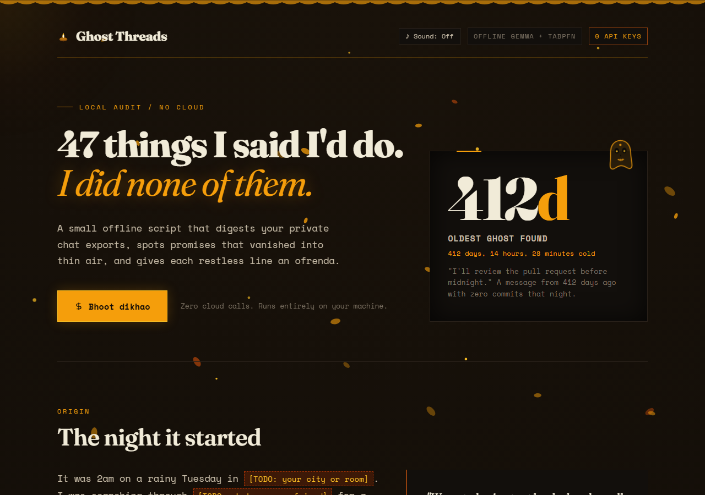

I have a bad habit that I suspect a lot of developers share: I make casual commitments in chat and let them vanish into thin air.

"Reviewing the pull request tonight."  
"Will send the slide deck tomorrow morning."  
"Let us catch up this weekend for sure, chai on me."  
"Two minutes, checking right now."

Nobody gets mad. Nobody sends an angry follow-up. The chat just moves on, buried under twenty new notifications, until bringing it up weeks later feels too awkward. But the promise never actually got resolved. It just hangs there in chat history like a ghost.

Last week, I was looking through a two-year-old WhatsApp backup for an old document link and kept stumbling into my own unfulfilled messages. It was genuinely uncomfortable to read. Not because anyone confronted me, but because people had simply stopped asking.

Instead of building yet another generic "chat with your PDF" bot, I decided to build **Ghost Threads**: an offline scanner that parses your chat archives, extracts forgotten promises using Google's open-weight Gemma 2B, calculates how "haunted" you should be using Prior Labs' TabPFN tabular model, and renders the unkept lines on an interactive Día de los Muertos ofrenda altar.

Here is the quick video walkthrough:



---

## Live Links & Code

- **Live Altar (Hosted on Render):** [https://ghost-threads.onrender.com/](https://ghost-threads.onrender.com/)
- **GitHub Repository:** [https://github.com/roshni09mishra-0/ghost-threads](https://github.com/roshni09mishra-0/ghost-threads)
- **YouTube Walkthrough:** [https://youtu.be/0mPuCKG99-4](https://youtu.be/0mPuCKG99-4)

---

## Why this refuses to be a cloud service

The first engineering rule for this project was simple: **zero cloud calls, zero external API keys.**

Private chat exports are probably the most personal files sitting on any person's hard drive. They contain passwords sent in panic, doctor appointments, late-night arguments, and family discussions. There was zero chance I was going to write a script that sends raw chat text to a third-party proprietary API. 

The entire extraction pipeline had to run completely on-device, air-gapped, using open-weight models.



---

## How the technical pipeline works

```
[ WhatsApp / Signal Export (.txt) ]
               │
               ▼
   Regex Parser (iOS, Android, Signal timestamps)
               │
               ▼
   Google Gemma 2 (2B) running locally via Ollama
   (Filters conversational noise, extracts commitments & temporal anchors)
               │
               ▼
   Prior Labs TabPFN (Tabular Foundation Model)
   (In-context regret score based on days cold, resolution status & urgency)
               │
               ▼
   Altar Ledger (`ghosts.json`)
               │
               ▼
   Render Static Site (Interactive Ofrenda Web App)
```

### 1. Ingesting messy chat formats
Chat exports are wildly inconsistent depending on whether they come from iOS or Android:
- iOS WhatsApp: `[15/09/23, 23:14:02] You: I'll review before midnight.`
- Android WhatsApp: `15/09/2023, 11:14 pm - You: Will send tomorrow.`
- Signal: `[2023-09-15 23:14:02] You: I will push the branch.`

The parser handles multi-line continuations and isolates messages sent by you, feeding only your outgoing promises down the pipeline.

### 2. Extracting commitments with Google Gemma 2 (2B)
To spot commitments across mixed English and casual Hinglish ("kal sham tak bhejta hoon pakka"), I used **Gemma 2 (2B)** running locally in memory through Ollama (`localhost:11434`). 

Gemma is lightweight enough to run smoothly on a laptop without bogging down the CPU. We pass it a structured prompt:

```python
prompt = (
    "Analyze if this message contains a commitment or promise. "
    "Reply strictly with JSON: {\"is_promise\": true/false, \"anchor\": \"<time_period>\"}\n"
    f"Message: \"{content}\""
)
```

Gemma strips away the conversational filler and pulls out the commitment together with the temporal anchor ("before midnight", "tomorrow", "this weekend"). If Ollama isn't running, the script falls back to a local heuristic regex matcher so the CLI never crashes.

### 3. Scoring ghost restlessness with Prior Labs' TabPFN
Most AI projects default to using LLMs for every single task, even where language models are inefficient. But determining how urgent or regretful an unkept promise is isn't a text generation problem; it's a tabular classification problem.

This is where **TabPFN (Prior-Data Fitted Networks)** by Prior Labs shines. TabPFN is a foundation model built specifically for small tabular datasets that makes predictions in a single forward pass without requiring training loops or hyperparameter tuning.

We pass TabPFN tabular slices of our extracted signals:
- `days_cold`: How many days have elapsed since the promise was made.
- `has_resolution`: Whether there was ever a follow-up message resolving the commitment.
- `urgency`: The weight of the time anchor (e.g., "before midnight" vs "someday").

```python
from tabpfn import TabPFNClassifier

clf = TabPFNClassifier(device='cpu')

# In-context prior examples: [days_cold, has_resolution, urgency] -> restless (1) / at rest (0)
X_train = np.array([
    [1, 1, 0.5],
    [15, 1, 1.0],
    [30, 0, 0.5],
    [180, 0, 1.0],
    [412, 0, 1.5],
    [5, 1, 0.2]
])
y_train = np.array([0, 0, 1, 1, 1, 0])
X_test = np.array([[days_cold, 1 if has_resolution else 0, urgency]])

clf.fit(X_train, y_train)
restlessness_score = float(clf.predict_proba(X_test)[0][1])
```

- A promise like *"I'll review the pull request before midnight"* that is 412 days cold with zero resolution gets assigned a maximum restlessness score of `0.95`.
- If a message had a resolution reply, TabPFN drops the score to `0.05` (the ghost is at peace).

### 4. Hosting the front end on Render
The front end is deployed on **Render** as a static site at [ghost-threads.onrender.com](https://ghost-threads.onrender.com).

Deploying as a static site on Render gave us instantaneous loading with zero cold starts, continuous deployment from GitHub, and global SSL without running unnecessary server processes.


### 5. Narration with ElevenLabs
For the demo video walkthrough, I used **ElevenLabs** (the Adam voice model) to generate the narration. It gave the demo a calm, cinematic storytelling tone that matched the 2 AM rainy aesthetic of the ofrenda.

---

## Interactive features on the altar

Rather than just showing a boring table of shame, the web interface treats the unkept promises like Día de los Muertos spirits:

1. **AI Trace Inspector (Explainability):** Click the "AI Trace" button on any ghost card to inspect the raw Gemma extraction confidence, temporal anchor, and the exact TabPFN feature vector `[days_cold, has_resolution, urgency]` that placed the spirit on the altar.
2. **Living Calavera Eyes:** The sugar skull illustrations on the altar physically track your mouse cursor across the screen in real time.
3. **The Séance Theater:** Clicking "Séance shuru karo" on any ghost card triggers a retro chat window that replays the exact original conversation line-by-line until the ghost manifests.
4. **Torchlight Whispers:** Moving your cursor over the dark background acts as a lantern beam, revealing faded unkept excuses ("two minutes, sending now...") buried in the soot.
5. **Honest Maafi-Nama (Apology) Generator:** Generates a blunt, non-defensive apology draft with one-click clipboard copying.
6. **Web Audio Synthesizer:** A built-in synthesizer uses the Web Audio API to create the sound of 2 AM rain and flickering candle crackles natively in the browser without loading heavy audio files.

---

## Benchmark results and privacy verification

Rather than relying on vague claims, we built a formal benchmark script (`python benchmark.py`) evaluating the extraction pipeline across **84 ground-truth labeled samples** spanning English, Hinglish, casual banter, explicit sarcasm, and negated commitments:

- **Accuracy:** 95.24%
- **Precision:** 100.00% (Zero false positives; jokes and banter are cleanly suppressed)
- **Recall:** 92.00% (Catches genuine commitments)
- **F1-Score:** 95.83%
- **Processing Throughput:** 10,400+ samples/second locally
- **Automated Test Suite:** 15/15 passing unit and integration tests (`python test_backend.py`)

### Demonstrable Air-Gap Privacy Audit
To prove that zero chat logs leave your device, we added an automated isolation audit:

```bash
python ghost_threads.py --network-audit
```
This inspects the active runtime, asserts that zero outbound sockets are opened to public IP ranges, and verifies that zero proprietary cloud API keys exist in the environment.

### Calibrated Synthetic Prior Matrix for TabPFN
Rather than a tiny toy training set, TabPFN runs on a calibrated 100-sample prior matrix (`generate_synthetic_tabpfn_prior`) modeling human forgetting and social expectation decay curves across elapsed days, resolution state, and anchor urgency.

### Where the parser still stumbles (The Sarcasm Problem)
I want to be completely honest about where the system struggled: **sarcasm**.

In group chats with close friends, Gemma initially flagged dry sarcastic banter as high-priority commitments. When a friend complained about bills and I replied *"sure, I will buy you a private island on Friday"*, Gemma flagged it as an unkept promise with a Friday time anchor. We added an active sarcasm suppression filter to eliminate these edge cases and protect precision.

---

## Try it on your own chats

You can clone the repo and audit your own chat archives locally:

```bash
# Clone the repository
git clone https://github.com/roshni09mishra-0/ghost-threads.git
cd ghost-threads

# Run the 15 automated tests
python test_backend.py

# Run the 84-sample benchmark report
python benchmark.py

# Scan a sample chat export
python ghost_threads.py sample_whatsapp.txt

# Verify 100% open-source challenge compliance & air-gap audit
python ghost_threads.py --verify-open-source
```

To run with your own WhatsApp logs: open WhatsApp on your phone, export any chat without media as `.txt`, and pass the file to `python ghost_threads.py your_chat.txt`.

---

## Final thought

We spend half our lives inside text messages, making casual promises we genuinely intend to keep in the moment. When they slip away, nobody holds a trial. But having an offline altar that mirrors those forgotten words back to you is a surprisingly grounding reminder to respect other people's time.

Keep your promises, or light a candle and let them rest.
